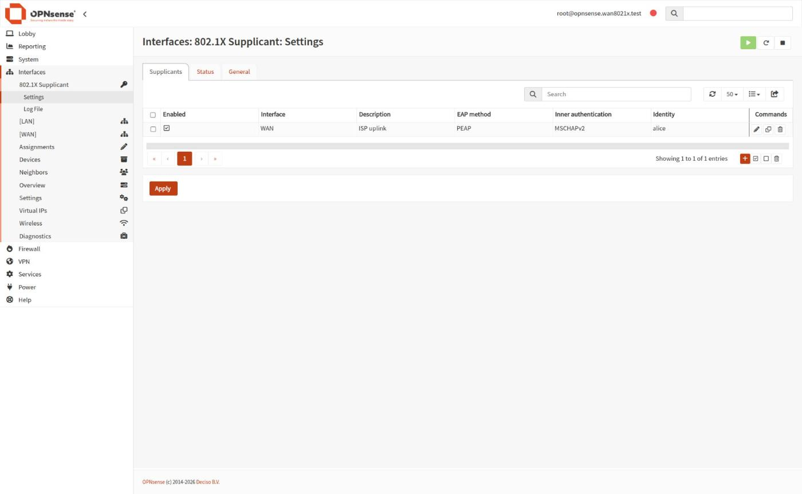
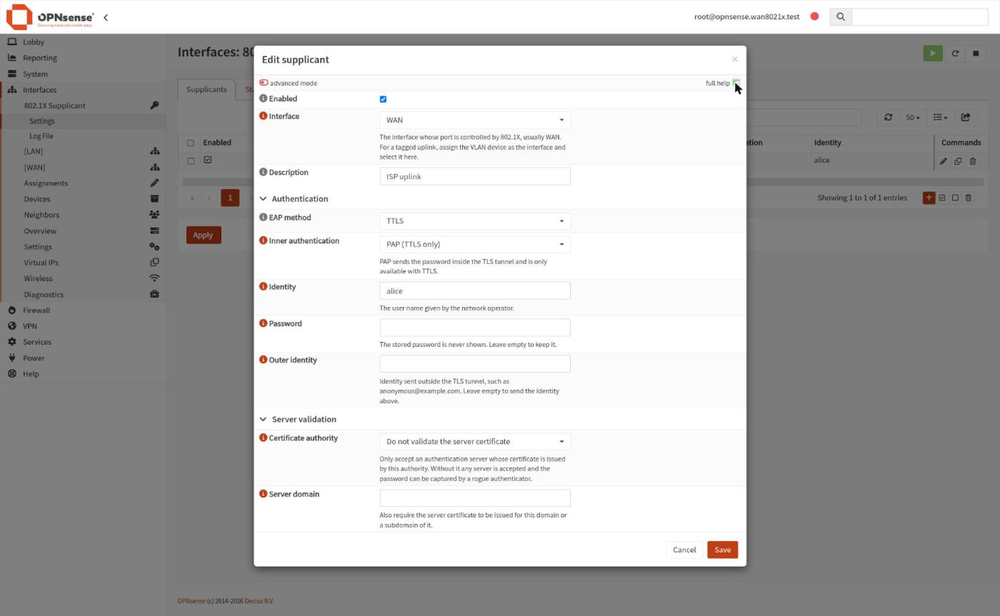
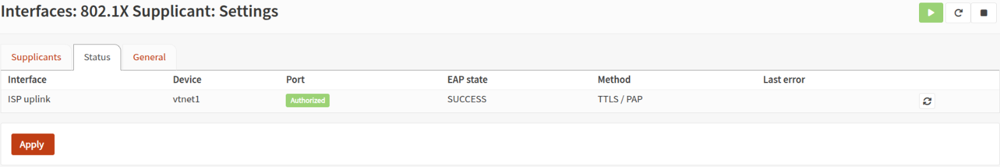
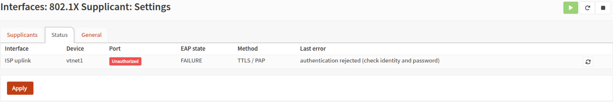

English | [简体中文](README.zh-CN.md)

# os-wan8021x — IEEE 802.1X supplicant for OPNsense WAN interfaces

Some ISPs, campus and enterprise networks put the uplink behind an 802.1X
controlled port: until the router authenticates, the switch drops everything
but EAPOL, so DHCP never gets a lease. OPNsense has no GUI for this on wired
interfaces. This plugin adds one.

* Menu **Interfaces → 802.1X Supplicant**, one supplicant per assigned
  interface, physical or VLAN
* PEAP or TTLS, inner MSCHAPv2 (TTLS also PAP), optional outer (anonymous) identity
* Optional server validation against a CA from System → Trust, plus domain suffix matching
* Starts at boot right after interface configuration (`early` hook); dhclient
  picks up the lease once the port opens
* Re-authenticates when the link comes back up (cable pull, switch reboot) and
  restarts a crashed supplicant
* Status tab with port state, EAP state, method and the last failure reason,
  plus a manual re-authenticate button; log file under the same menu
* Password is write-only in the API and GUI, the generated configuration is
  root-only (0600) and credentials are never logged

| Settings | Edit |
|---|---|
|  |  |




Targets OPNsense 26.7 (FreeBSD 14). The plugin lives in `net/wan8021x/` with
the same layout as [opnsense/plugins](https://github.com/opnsense/plugins), so
it can be submitted upstream as is.

## How it works

```
GUI / API ──► config.xml ──► setup.php ──► /var/etc/wan8021x/<dev>.conf (0600)
                                              │
rc.d/wan8021x ──► daemon(8) ──► wan8021xd.py ─┼─► wpa_supplicant -D wired -i <dev>   (one per interface)
                                              ├─► control socket: EAP events → status.json
                                              └─► route -n monitor: link DOWN→UP → REAUTHENTICATE
```

* `wpa_supplicant` is the one OPNsense itself ships (`/usr/local/sbin`, wired driver).
* Identities, passwords and domains are written hex encoded, so quotes,
  backslashes and UTF-8 need no escaping.
* The FreeBSD wired driver does not notice link changes. After a cable pull
  the switch resets the port while the supplicant still believes it is
  authenticated, so the daemon follows link state itself. devd cannot be used
  for this: it runs only the highest priority rule per event, which is core's
  `rc.linkup`.

Background and measurements: [docs/research.md](docs/research.md).

## Repository layout

```
net/wan8021x/      the plugin (opnsense/plugins layout)
env/               test environment: vm/ (QEMU/KVM), auth/ (authenticator), dev/ (tooling), provision/
tests/e2e/         end-to-end tests (pytest)
tools/             vmctl.py, vmlib.py, lint.sh, stage.sh, bin/vm-ssh
.github/workflows/ CI (lint + FreeBSD build) and tag-driven releases
spikes/            the scripts behind docs/research.md
vendor/plugins     opnsense/plugins @ 26.7.7 (Mk/, Templates/, … are symlinked from here)
vendor/core        opnsense/core @ 26.7.7 (lint rules, ruleset.xml)
docs/              roadmap, research notes, test environment
.cache/            downloaded images, VM disks, keys, logs (git-ignored)
```

## Development

The host needs docker with compose, git and `/dev/kvm`. Everything else
(QEMU, hostapd, PHP and Python tooling) is built from `env/*/Dockerfile`, and
all inputs (OPNsense image + SHA256, base image digest, Debian snapshot,
phpcs) are pinned in `env/versions.env` and the Dockerfiles.

```sh
git clone --recurse-submodules https://github.com/davidliyutong/opnsense-wan8021x.git
make tools            # build the local images
make image golden     # download + verify OPNsense 26.7 nano, provision the golden disk (~1 min, once)
make reset            # fresh VM from golden + authenticator (~20 s)
make deploy           # build the package inside the VM and install it
make test             # end-to-end tests against the running VM (TESTARGS="-k vlan")
make lint             # phpcs/pycodestyle/shellcheck locally + upstream "make lint" in the VM
make lint-local       # only the local checks (no VM), as run by CI
make ci-local         # the GitHub workflows under act, capped like a GitHub runner
make check            # lint + reset + deploy + test (~3 min)
make package          # .cache/pkg/os-wan8021x-devel-*.pkg
make help             # everything else (console, ssh, logs, down, …)
```

GUI: https://127.0.0.1:18443 (root / opnsense, self-signed certificate);
ssh: `make ssh`. Ports are set in `env/versions.env`.

### CI and releases

Every push and pull request runs `make lint-local` in the pinned dev image
and, in a FreeBSD 15 VM (the base of OPNsense 26.7), the upstream
`make lint` and `make package`; the `-devel` package is kept as a workflow
artifact. The end-to-end tests need `/dev/kvm` plus the authenticator and stay
local (`make check`). The workflows also run locally with act
(`make ci-local`); see [docs/testenv.md](docs/testenv.md) for the resource
limits and measured usage.

To release, set `PLUGIN_VERSION` in `net/wan8021x/Makefile`, then push a
matching tag (`v0.1`, or `v0.1_1` with `PLUGIN_REVISION=1`). The release
workflow builds `os-wan8021x-<version>.pkg` (without the `-devel` suffix) and
publishes it with a `SHA256SUMS` file as a GitHub release.

### Test environment

```
 127.0.0.1:18443/12222 ─► vm container: qemu-system-x86_64 -enable-kvm (OPNsense 26.7 nano)
                              vtnet0 = LAN (QEMU user net, management)
                              vtnet1 = WAN ── tap-wan ──┐
 auth container (same netns):                           │
   hostapd -D wired on tap-wan, tap-wan.100 and tap-wan.200 (VLANs), built-in EAP server
   nftables: only EAPOL passes until hostapd authorizes the MAC
   dnsmasq: 172.31.0.0/24 untagged, 172.31.100.0/24 and 172.31.200.0/24 on VLAN 100/200
```

Test accounts: `alice` / `alice-secret` (PEAP, TTLS-MSCHAPv2, TTLS-PAP),
`bob` / `bob-secret`, and a user with a backslash and UTF-8 in the name and a
password with quotes (see `env/auth/eap_user`). The authenticator can pull the
VM's cable, reset ports and report authorized MACs (`authctl`); the tests reach
it via `.cache/run/authctl.sock`. Details: [docs/testenv.md](docs/testenv.md).

The 33 end-to-end tests cover all methods, wrong password, rogue CA and
domain mismatch, special characters, link loss, manual re-authentication, crashed, hung or
unstartable supplicants, starting with the link down, VLAN uplinks, two VLANs at once,
interface reassignment, reboot, upgrade and uninstall, validation,
secret handling and the GUI page.

## Status and limitations

Milestones M0–M5 are done; packaging works, upstream submission is pending.
See [docs/ROADMAP.md](docs/ROADMAP.md).

* EAP-TLS (client certificates), EAP-MD5 and PPPoE over an 802.1X port are not supported yet.
* The EAPOL destination is always the PAE group address `01:80:c2:00:00:03`;
  wpa_supplicant has no option to change it. Use the interface's own
  promiscuous mode and MAC spoofing settings where an authenticator needs them.
* Tested against hostapd's EAP server only, not a real RADIUS server or a real switch.

## License

BSD 2-Clause, as OPNsense.
